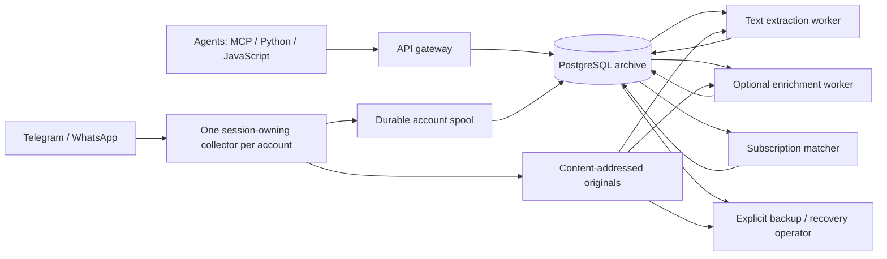

# Architecture and verification boundaries

DeedKit is one repository with independent gateway, messaging, calendar, calls and recordings
services. Each service keeps its own lockfile, process, API and durable state. The
common MCP exposes only explicitly selected tools and never imports provider code.
See [module runtime contracts](docs/platform-runtime.md).

The AnyMsg messaging module has a shared PostgreSQL archive, with independently
invoked workers and two HTTP client packages. Logical components describe
responsibility and verification boundaries. They are not a promise of one
container, package or database per component.

## Logical components

The first column gives the exact Tiden component names. The `AnyMsg` prefix
marks the messaging module's components and keeps their historical identity.
Paths are relative to this repository; a source anchor identifies an
implementation location, not proof that its behavior has been tested. Each
component's path list in Tiden is the complete scope; the table names its
principal sources.

| Component | Responsibility and principal sources | Verification boundary |
| --- | --- | --- |
| AnyMsg Gateway & Access | `app.py`, `policy.py`, `commands.py`, `outgoing.py`, `send_wait.py`, `messenger_operations.py`, `formatting.py`, `presentation.py`, `security_logging.py`, `error_details.py`, `feedback.py`, shared `store.py`, gateway SQL role | REST/MCP contracts, authorization, redaction, typed arguments, safe error codes, preview and mutation fences, bounded observation of queued sends and private agent feedback |
| AnyMsg Archive & Search | `archive.py`, shared `store.py`, `envelope.py`, `adapters.py`, `spool.py`, collector state/control and operational modules, query/evidence modules, `conversation.py`, `conversation_state.py`, `people.py`, `reviews.py`, `receipts.py`, `reply_state.py`, `reply_evidence.py`, `incoming_formatting.py`, `history_plan.py`, `deploy/history-policy.example.json`, collector SQL role, `message_purge.py` with the purge SQL role and `deploy/compose.message-purge.yaml` | Transactions, revisions, conflicts, scope, cursors, coverage, normalized conversation views, exact reply proofs, explainable reply hints and the content-free purge of deleted messages |
| AnyMsg Telegram Connector | `telegram_collector.py`, pairing, governor, identity, receipts and operations modules, Telegram deployment examples | Synthetic Telethon adapters, durable cursors, FloodWait, session/lease fences and native-operation outcomes |
| AnyMsg WhatsApp Connector | Primary whatsmeow adapter `whatsapp/whatsmeow/` for new connections; whatsapp-web.js fallback and rollback adapter `whatsapp/*.mjs`; `whatsapp_collector.py`, pairing/identity modules, `whatsapp_capabilities.py`, WhatsApp deployment examples | Synthetic provider/IPC tests for both adapters, command lanes, history bounds, identity evidence, account provider identity, passive receipts and media handling |
| AnyMsg Media Storage & Index | `blobs.py`, `storage_admission.py`, `media_policy.py`, `media_requests.py`, `attachment_metadata.py`, `uploads.py`, `file_extract.py`, `file_index.py`, `file_lifecycle.py`, indexer and file-lifecycle SQL roles, `deploy/compose.file-lifecycle.yaml` | Original integrity, scoped retrieval, bounded original requests and staged uploads, extraction safety, passages, provenance, derivative invalidation and reuse, operator-only original residency |
| AnyMsg AI Enrichment | `enrichment.py`, `enrichment_providers.py`, `codex_enrichment.py`, `file_understanding.py`, `resource_admission.py`, enrichment SQL role, file-understanding deploy overlay and role, enrichment requirements and root `enrichment.*.example.json` | Budgets, isolated processing, profile validation, result fences, independent file descriptions and untrusted model output |
| AnyMsg Subscriptions & Events | `subscriptions.py`, `subscription_worker.py`, `subscription_consumption.py`, `processing_events.py`, `event_delivery.py`, `delivery_worker.py`, `heartbeats.py`, subscription and delivery SQL roles, `deploy/compose.subscriptions.yaml`, `deploy/compose.delivery.yaml`, `scripts/delivery_egress_check.py`, `packages/wake-relay/` (host receiver) | Key ownership, committed frontier, lifecycle/version checks, fair matching, atomic checkpointing, receipt-bound ACK, signed hints that never ACK, artifact references and the host relay that turns a hint into one assistant run |
| AnyMsg Backup & Recovery | `backup.py`, crypto, runner, worker, receiver, R2 receiver/verifier, restore worker and recovery modules; R2 examples, verifier systemd units and R2 requirements | Consistent table/blob manifests, encrypted transfer, restore equality, quarantine and retention anchors |
| AnyMsg Deployment & Verification | SQL migrations, `schema.sql`, `__init__.py` version, `release.py`, `telemetry.py`, root `Dockerfile`, Compose overlays, messaging packaging (`services/messaging/` Dockerfile, `pyproject.toml`, `hatch_build.py`, lockfiles), root `uv.lock`, release and branch-protection examples in `deploy/`, `services/release-router/`, `.github/`, `scripts/`, `tools/dev/` | Schema checksums, least privilege, images/packages, release routing, synthetic network drills and authentic CI evidence |
| AnyMsg Python Client & Operator CLI | `services/messaging/anymsg/`, `__main__.py` operator entry point, root `client_check.py` and `media_benchmark.py`, packaged assets | Safe HTTP client, token-file CLI, source assets and explicit owner administration |
| AnyMsg JavaScript Client | `packages/npm/` (`anymsg`), `packages/deedkit/` (`deedkit`) | Dependency-free HTTP clients for the messaging server and the DeedKit gateway, local argument validation, TypeScript declarations and token-file CLIs |
| Recording Integrations | `services/recordings/` | Optional independent provider reads, per-credential account/content ceilings, bounded on-demand Omi/PLAUD reads, opt-in private SQLite Omi text archive and FTS index; no audio download or provider login |
| Platform Gateway | `services/gateway/`, gateway Compose overlays | Selected module tools, exact action ceilings, per-principal backend credentials, bounded original downloads and preserved domain receipts, without provider sessions |
| Family Calendar | `services/calendar/`, calendar Compose overlay | Google and CalDAV accounts, explicit roles and grants, plan/apply receipts, encrypted provider credentials and a singleton synchronization worker |
| Voice Calls | `services/calls/`, calls Compose overlays | Principal-owned briefs and call tasks, durable follow-ups and owner decisions, scoped messaging context, Pipecat runtime and signed provider media boundaries |
| Platform Integration & Operations | `tests/platform/`, `docs/quality/`, `packages/platform-contracts/`, `config/`, Tiden snapshot and preservation scripts | Migration compatibility, specification/test identity preservation and cross-module verification |

Bare file names in the table are under `services/messaging/messaging_service/`;
paths with a directory are relative to the repository root, and root files are
marked as such. `store.py` supplies shared transaction/authorization and
dispatch infrastructure; components may intentionally overlap there. The
operator entry point and schema migrations likewise cross domain boundaries.
The Tiden snapshot and preservation scripts belong to both Deployment &
Verification (through `scripts/`) and Platform Integration & Operations.
Do not interpret a change in a shared file as coverage of every affected domain.

## Data flow and process boundaries

This diagram omits the reverse-proxy and database deployment details. Sending
and native operations are authorized and persisted by the gateway, then claimed
by the existing account collector; they do not start a second provider client.
Original, extracted-text and model-result readiness are separate states and
events. Subscription inspection reads committed matches without provider polling
or acknowledging another agent's work.

## Implemented behavior versus planned work

The maintained specs describe behavior present in the development source,
including experimental features. `Active` means a maintained implementation
contract; it does not mean every clause is verified or that all optional workers
are enabled in an installation. Registry versions can lag development; consult
the version notes in [README.md](README.md).

Examples of boundaries that must stay explicit:

- `get_file_segments` paginates timestamped audio transcription segments.
  `search_files` returns matched document passages; `get_file_text` reads text
  and document source spans. There is no query argument to `get_file_segments`.
- `history-plan` previews a recent-first plan. Durable multi-wave execution is
  planned; a successful preview does not prove provider history was downloaded.
- Subscriptions are durable. Passive event reads never ACK; explicit
  receipt-bound ACK and operator-registered signed hints are implemented. A
  delivered hint is neither an ACK nor a verified host turn. Host wake-up
  remains planned; a hint or a new MCP result alone cannot activate an idle agent.
- Owner-read observations, recipient delivery/read receipts and a credential's
  local reply dismissal are different evidence. Passive reads do not send a
  provider read receipt.
- Original deduplication and context-bound derivative reuse are implemented.
  Opt-in managed eviction of unpinned originals and best-effort recovery
  through the collector are implemented; eviction requires usable current
  processing unless the operator explicitly expires old unprocessed originals.
  A cold archive before eviction with verified rehydration, and independent AI
  artifact reuse, remain planned. An unavailable original is not a download
  guarantee.
- Container defaults describe the deployment template. Synthetic tests do not
  prove current provider completeness, transcription quality, server capacity
  or health of an off-site backup receiver.

Future behavior belongs in the existing Tiden product as queued requirements or
an explicitly scoped change intent. [BACKLOG.md](BACKLOG.md) is its navigation
and historical-ID index. Follow the [product workflow](docs/operations/tiden-product-workflow.md);
future behavior must not silently become an implemented baseline during a scan.

## Evidence and reconciliation

Each spec keeps its stable identity and historical sources. Correct an inaccurate
claim by adding the reviewed source revision and updating the contract; do not
erase its history or rename a test to make a result appear applicable.

Test links require an assertion review against the relevant acceptance criteria.
Record which behavior the test establishes and what it does not establish.
A test can cover one clause without proving an entire broad feature. Split
independent requirements when needed rather than attaching every test in a
directory to a broad parent. Coverage gaps stay visible until evidence exists.

CI records authentic source identities, outcomes and the tested checkout SHA.
Tiden's workflow status and its verification status are separate: a maintained
`Active` spec can still have `no_test`, `not_run` or a failed test. Follow
[TIDEN-CI.md](TIDEN-CI.md) for branch mapping and evidence association.
